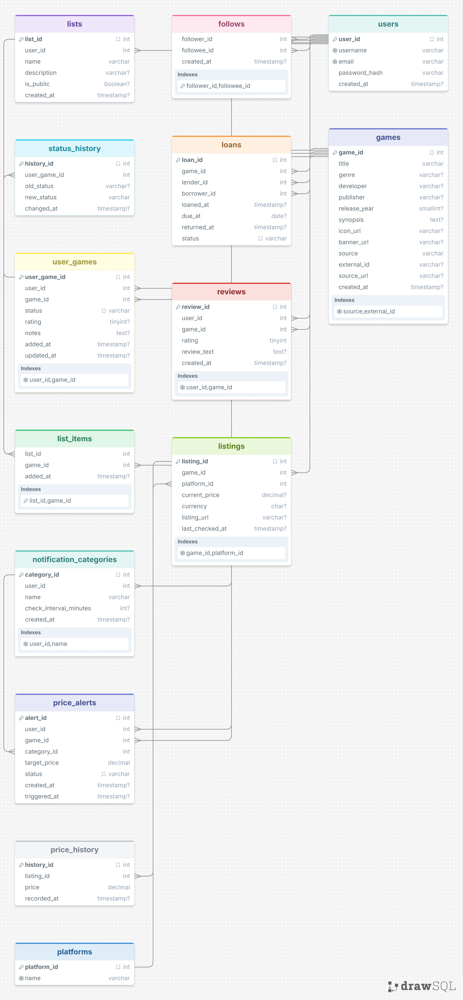

#  GameBuddy | CS 514 Final Team Project
Design Planning: https://docs.google.com/document/d/1SZhi5rWudaYoxWQ4refjZ3xmhEVcpnUgkQmJFg961Mw/edit?usp=sharing

Website Link: https://sites.google.com/view/gamebuddyfs

Live app: https://gamebuddy-production.up.railway.app/

## What it is
A multi-user game wishlist manager and price tracker. Sites like gg.deals
track prices across major platforms but treat every wishlist item the same
way, bombarding you with notifications regardless of how much you actually
care about a given game and they don't cover niche platforms (VR, retro,
mods, mobile). This app lets you build a wishlist across any platform, see
current and historical prices, and organize games into your own notification
categories (e.g. "hunting hard" checked hourly, vs. "someday maybe" checked
weekly) so you only get pinged about what you actually care about.

## Team
- David Nguyen - Team lead, floats across database, backend, and testing/benchmarking
- Eugene Vinnichenko - Backend & database
- Elmer Mendez - Backend Support and Presenting & Website
- Brandon Tse - Frontend Support and Testing/benchmarking
- Harish Raaj Sivakumar - Frontend 

## Tech stack
| Layer    | Technology |
|----------|------------|
| Frontend | React 18, React Router v6, Vite |
| Backend  | Flask 3, Flask-JWT-Extended (logins), Flask-SQLAlchemy + plain SQL |
| Database | MySQL (`schema.sql` — tables, views, stored procedures) |
| Data     | Python import scripts (Steam, GOG, Epic) |
| Deploy   | Railway (Docker, Gunicorn) |

## Project structure
```
multimedia-LMS/
├── schema.sql            # THE database schema (tables, view, stored procedures)
├── init_db.py            # applies schema.sql to your db (no workbench needed)
├── sample_queries.sql    # the queries the backend uses, grouped by feature
├── import_steam.py       # pull game details + prices from each store...
├── import_GOG.py
├── import_Epic.py
├── import_appstore.py    # mobile games (App Store, phase 2)
├── game_matching.py      # ...so the same game from 3 stores = 1 game
├── backend/
│   ├── app.py            # flask app (serves the api + the built frontend)
│   ├── db.py             # helpers for running plain SQL from routes
│   ├── models.py         # SQLAlchemy models (used by login + library)
│   └── routes/
│       ├── auth.py       # /api/auth — register, login, me
│       ├── games.py      # /api/games — search, game page, dashboard list
│       ├── watchlist.py  # /api/watchlist, /api/search, /api/alerts, /api/categories
│       ├── library.py    # /api/library — games you own (phase 1.5)
│       ├── submissions.py # POST /api/games — user-added games + mods (phase 2)
│       └── social.py     # /api/users, /api/feed, reviews (phase 2)
├── frontend/             # react app (vite)
├── tests/testwishlist.sql
├── Dockerfile            # railway build: node builds frontend, python serves it
├── dev.sh / dev.bat      # run backend + frontend locally (mac/linux / windows)
└── API.md                # every endpoint + its JSON
```

The frontend + backend used to live in a separate repo
(harish950/gamebuddy) — it was merged in here with its history on Nov 20.

## Run it locally
You need Python 3.11+, Node 20+, and MySQL 8.

1. `pip install -r requirements.txt`
2. Copy `.env.example` to `.env` and fill in your MySQL password.
3. `python init_db.py` — creates the `game_tracker` database from
   `schema.sql`. Safe to run again.
   **If you have an old database from before Nov 20:** the tables changed,
   so `DROP DATABASE game_tracker;` first, then run it.
4. `python import_steam.py` (and `import_GOG.py` / `import_Epic.py` /
   `import_appstore.py`) to pull real games + prices in.
5. Start everything:
   - Windows: `dev.bat`
   - Mac/Linux: `./dev.sh`

   then open http://localhost:3000 and register an account. Vite forwards
   `/api` calls to Flask on :5001, so no CORS setup needed.

`tests/testwishlist.sql` adds a demo user + wishlist item if you want test
data without registering.

## Deploying (Railway)
The `Dockerfile` builds the React app in a Node stage, then a Python stage
serves the API and the built frontend from one Gunicorn process. Railway
injects `DATABASE_URL`, `SECRET_KEY` and `JWT_SECRET_KEY`. After the first
deploy (or whenever schema.sql changes), run `python init_db.py` once with
`DATABASE_URL` pointed at the Railway database.

## Phases
- **Phase 1** — price tracking + wishlist with notification categories
- **Phase 1.5** — "my library": games you already own aren't price tracked
  (`backlog` / `playing` / `completed`), with what you paid and saved
- **Phase 2** — user-added games + mods, price ranges ("between $X and $Y"),
  mobile (App Store), filters by tag / store type, and social (follows,
  profiles with privacy, friends feed, reviews, friends who want a game)

See `API.md` for every endpoint.

## ER Diagram


